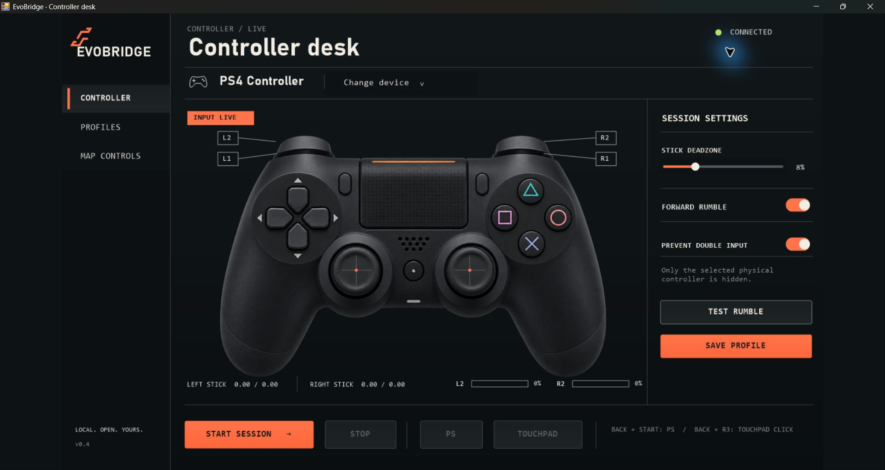

# EvoBridge

**Your controller. A virtual DualShock 4. No subscription.**

EvoBridge is a Windows desktop mapper for Xbox/XInput controllers and SDL-supported gamepads. It reads a selected physical controller, sends its input to an unmodified local [VIIPER](https://github.com/Alia5/VIIPER) backend, and exposes a virtual USB DualShock 4. Optional HidHide integration prevents applications from receiving both physical and virtual input.



*Actual screenshot of EvoBridge maximized on Windows, with a connected controller in live input preview.*

## Download and start

1. Download the Windows x64 ZIP from [Releases](https://github.com/gurugsv7/EvoBridge/releases). Extract the whole folder to a writable location. This is an unsigned experimental application; Windows may display a reputation warning.
2. Install the signed **USB/IP client/tools** from [usbip-win2](https://github.com/vadimgrn/usbip-win2/releases/tag/v.0.9.8.1). Version 0.9.8.1 was tested. Allow its driver installation and restart if requested. EvoBridge looks for `usbip.exe` in `C:\Program Files\USBip` or PATH.
3. For **Prevent double input**, install [HidHide](https://github.com/nefarius/HidHide/releases/tag/v1.5.230.0). Version 1.5.230 was tested. Reconnect the physical controller after installation and close the HidHide configuration client before starting a session.
4. Connect and wake your controller. Close other controller mappers. Run `EvoBridge.exe`, use **Change device**, then **Start session**. Choose **Stop** when finished.

Requires Windows 10/11 **x64** with .NET Framework 4.8. Drivers are installed separately and are not bundled or installed automatically. Driver installation needs administrator approval; ordinary mapping sessions should not. Never run two EvoBridge versions together. Keep all extracted files together.

## What it does

- Automatic device detection with saved per-device names, deadzone, rumble, hiding and mappings.
- Live controller preview, stick values, trigger meters and button highlights.
- A guided mapping flow for devices SDL does not already recognize, with a review before saving.
- Standard DS4 output, PS and touchpad-click actions, and rumble forwarding where the physical device supports it.
- Selected-device hiding with restoration on Stop or normal exit. Shared receiver configurations that cannot be safely isolated are rejected.

Default shortcuts: **Back + Start → PS** and **Back + right-stick click → touchpad click**. A pad without a touch surface cannot provide real finger tracking or gestures. The on-screen PS and Touchpad actions are also available.

Profiles are saved beside the executable. A reported stable serial is preferred for identity; devices without one may require a separate profile after a port or transport change. This version selects one physical input and produces one virtual controller per session.

## Compatibility and verification

**Testing update — November 14, 2026:** The maintainer confirms successful end-to-end testing with Sony PS Remote Play and a live PS5. All controllers tested by the maintainer are working. The model-specific results recorded below cover the named configurations; this is not a claim that every controller model and connection type on the market has been individually tested.

| Input | Verified locally | Limits |
| --- | --- | --- |
| EvoFox Elite X2, dongle/XInput | Buttons, sticks, triggers, rumble; selected-device hiding | One model and transport |
| Ant Esports GP400, XInput | Buttons, sticks, triggers and rumble | One model and transport |
| Ant Esports GP400, PS4/HID mode | Buttons, sticks, triggers, rumble; virtual-only visibility during a session | This is a recognized HID pad, not proof for every generic device |
| Additional controllers | Maintainer reports all tested controllers working | Additional model and transport details are not individually recorded here |
| Sony PS Remote Play | Successful live PS5 session confirmed by the maintainer | Exact client version and full per-controller test matrix are not recorded here |

The virtual DS4 was recognized by Steam and SDL, and physical vibration was confirmed during local hardware testing. This is DS4 emulation, with no DualSense adaptive-trigger or advanced-haptics emulation. Compatibility with every generic or Xbox controller is not guaranteed.

The software suite contains **34 checks** covering report encoding, local protocol behavior, profile persistence, exact-device safety and simulated generic mapping. Hardware validation is separate; CI cannot prove physical rumble or Remote Play compatibility.

## PS Remote Play: older Windows version

For troubleshooting crashes in newer PS Remote Play releases, **8.5.0.08070** is the older version used during local setup. Find it on [Uptodown's PS Remote Play version history](https://ps5-remote-play.en.uptodown.com/windows/versions) and select **8.5.0.08070**. This is a third-party download page, not Sony's website.

For the update-check workaround used during local setup, follow [Remote Play 8.5: backup, patch, install and restore](docs/remote-play-8.5.md). An optional copy-only PowerShell patcher is included; EvoBridge does not apply it automatically or bundle Sony's installer or executable. The maintainer has since confirmed a successful live PS5 session with EvoBridge. The update-check workaround is separate from controller compatibility and is only relevant if your Remote Play installation needs it.

## Build from source

In Windows PowerShell, from the repository folder:

```powershell
./build.ps1
./scripts/Test.ps1
./scripts/Package.ps1
```

If your execution policy prevents local scripts, review them first and use a process-scoped policy appropriate for your machine. No global policy change is required. The build uses the .NET Framework x64 compiler included with Windows. Dependency downloads are pinned by version and SHA256; no NuGet or Node dependency tree is needed. `Package.ps1` rebuilds and reruns checks before creating the ZIP and `SHA256SUMS.txt` in `dist`.

The portable ZIP includes the unmodified VIIPER binary, its GPL licence and matching source archive, plus SDL and its licence. It contains no saved profiles, device IDs, input-hiding journal or private hardware reports. The frontend source is in this repository.

## Recovery and privacy

Choose **Stop** and close EvoBridge before moving its folder. If an unexpected termination leaves physical input hidden, close EvoBridge and run **Restore physical input.cmd** from the same folder. Keep `input-hiding-state.json` until restoration succeeds: it records which entries this copy added. If needed, use HidHide's configuration client to disable device hiding manually.

EvoBridge does not request PSN credentials and contains no analytics service. Its backend is bound to loopback ports **39421/39422** and update notifications are disabled. Profiles and optional diagnostic reports can contain device serials or Windows device paths; inspect and redact them before sharing. The repository ignores local profiles, journals and build outputs.

## Licence and contributions

Original EvoBridge code is [MIT licensed](LICENSE). VIIPER is a separate unmodified **GPL-3.0** program; SDL uses the **zlib** licence. Read [third-party notices](THIRD_PARTY_NOTICES.md) before redistribution. Driver projects retain their own licences. This project is independent of Sony, Microsoft, controller vendors and reWASD.

Bug reports and hardware compatibility results are welcome; see [contributing](CONTRIBUTING.md). Please describe only the combinations you actually tested.
